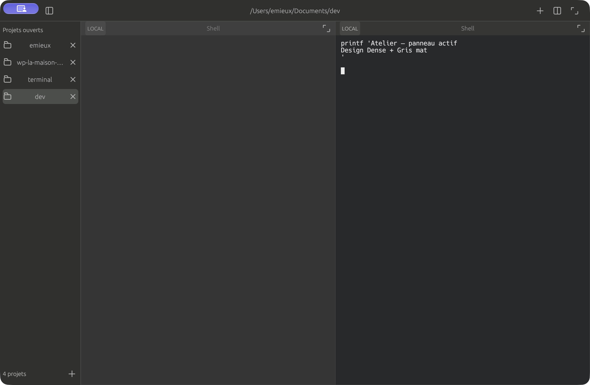

# Atelier

Un terminal macOS organisé par projets, développé en Rust avec egui et le moteur de terminal Alacritty.



## Installation

1. Télécharger le **DMG Apple Silicon** dans les [Releases](https://github.com/emieuxcharles/atelier-terminal/releases).
2. Ouvrir le DMG et glisser **Atelier.app** dans **Applications**.
3. Lancer Atelier depuis Applications.

Cette première version est signée **ad hoc**, sans certificat Developer ID ni notarisation Apple. Si macOS bloque son ouverture, tenter de la lancer puis aller dans **Réglages Système → Confidentialité et sécurité → Ouvrir quand même**, uniquement si vous faites confiance à cette distribution. Sur les anciennes versions : Préférences Système → Sécurité et confidentialité.

## Compatibilité

| Plateforme | Prise en charge de cette distribution |
| --- | --- |
| Mac Apple Silicon (M1 et suivants) | DMG arm64 |
| macOS 11 Big Sur et suivants | Minimum déclaré à la compilation ; toutes les versions ne sont pas testées |
| Mac Intel | Aucun binaire fourni pour cette première release |
| Windows / Linux | Non pris en charge |

Le minimum technique ne constitue pas une validation sur chaque version de macOS. L'application utilise les shells et outils présents sur votre Mac ; Docker, SSH et tmux ne sont pas inclus.

## Utilisation

Ouvrez un dossier comme projet, puis divisez son terminal en plusieurs panneaux. Les projets gardent leurs shells actifs pendant que l'application est ouverte. Les thèmes clair, sombre et système ainsi que la taille du texte sont réglables.

| Action | Raccourci |
| --- | --- |
| Ouvrir un projet | ⌘O |
| Diviser le terminal | ⌘D |
| Palette de commandes | ⌘⇧P |
| Réglages | ⌘, |
| Fermer le projet | ⌘W |
| Rouvrir le dernier projet fermé | ⌘⇧T |
| Projet précédent / suivant | ⌥⌘↑ / ↓ |
| Panneau précédent / suivant | ⌥⌘← / → |
| Agrandir / rétablir le panneau | ⌥⌘Entrée |
| Afficher / masquer les projets | ⌘B |

La palette donne aussi accès aux actions Docker Compose : démarrer, arrêter, consulter les logs et ouvrir un shell dans un conteneur. Docker et son plugin Compose doivent être installés. Les badges distinguent les sessions locales, SSH et Docker reconnues par Atelier.

Les projets, leur disposition et les préférences sont enregistrés dans `~/Library/Application Support/Atelier/state.json`. Au redémarrage, **de nouveaux shells sont créés** : les processus et le contenu des terminaux ne sont pas restaurés. Fermer un projet termine ses shells sans supprimer son dossier.

## Développement

Prérequis : macOS, outils de ligne de commande Xcode (`xcode-select --install`) et Rust stable avec Cargo.

```sh
sh scripts/cargo.sh run --release --locked
sh scripts/cargo.sh test --locked
sh scripts/bundle.sh
sh scripts/dmg.sh
```

L'application est produite dans `dist/Atelier.app` et le DMG dans `dist/`. Les scripts utilisent Rust depuis le PATH, ou `.toolchain` si une installation locale existe.

## État du projet

Version expérimentale : la compatibilité des applications terminal et des méthodes de saisie reste à valider. Sauvegardez votre travail avant de fermer un projet. Pour conserver un processus distant après fermeture, utilisez par exemple tmux sur le serveur.

- [Notes techniques et historique des validations](docs/development-history.md)
- [Audit de performances et limites des mesures](docs/performance/2026-11-12-audit.md)

Les dépendances adaptées `vendor/egui_term` et `vendor/muda` conservent leurs licences amont. Atelier s'appuie sur egui/eframe, Alacritty et muda.
